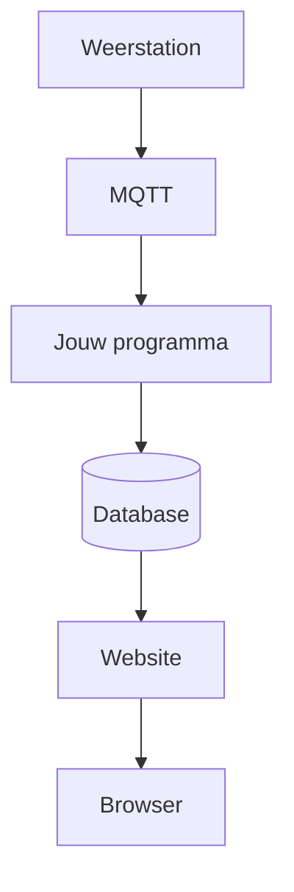

# Weerstation

Je bouwt een website waarop je kan inloggen en de metingen van je eigen weerstation ziet. Temperatuur en luchtvochtigheid komen binnen, belanden in een database, en verschijnen als tabel en als grafiek.

Het weerstation zelf is een ESP32 met MicroPython. Dat toestel publiceert zijn metingen. Jij bouwt de site die ze toont. Tot dat station er is, laat je je eigen Python-programma testmetingen sturen. Zo kan je verder zonder op de hardware te wachten.

Op het einde draait die site op een computer op school, en daarna op een server. Die stappen komen later. Eerst antwoordt een programma op je laptop.

## Wat je eerst maakt

Het eerste resultaat is nog geen afgewerkte pagina. Het is een Python-programma dat metingen teruggeeft als je erom vraagt. Dat programma kan je meteen testen: in de browser, op een testpagina, met een commando, en met een automatische test.

Daarna maak je de pagina in HTML en CSS, en laat je het programma die pagina serveren. De database, het inloggen en het echte station komen pas als dat staat.

## Volgorde

De volgorde ligt vast. Elk hoofdstuk gaat ervan uit dat het vorige af is.

1. [VS Code](vscode.md), de editor waarin je werkt.
2. [Git en GitHub](github.md). Je maakt een private repository en deelt die met je leerkracht. Vanaf dan bewaar je elk werkend stuk daar.
3. [Een eerste API](fastapi.md). FastAPI antwoordt met metingen, en je test dat op vier manieren.

Daarna, in deze volgorde:

4. HTML, de structuur van de pagina.
5. CSS, de vorm.
6. De pagina laten komen uit FastAPI.
7. Databases vergelijken, en daarna SQL gebruiken voor gebruikers, stations en metingen.
8. De metingen op de pagina zetten, eerst als tabel, dan als grafiek.
9. Wachtwoorden en inloggen. Een wachtwoord heeft pas zin als de site data van een gebruiker toont. Dan bespreken we waarom dat wachtwoord gehasht in de database staat. Een gewone gebruiker ziet alleen zijn eigen stations. Een beheerder ziet ze allemaal. Die controle zit in het programma, niet alleen in een verborgen menu.
10. MQTT, zodat metingen van het weerstation in de database belanden.
11. SSH en de computer op school.
12. De site op een server zetten.

## Hoe je deze cursus gebruikt

Je typt de code zelf in je eigen repository. Elk hoofdstuk eindigt met **Klaar als**: daaraan zie je of je verder mag.

Werk je vast, lees dan eerst het blok *Als het niet lukt* in dat hoofdstuk. De cursus blijft staan. Een hoofdstuk dat je later opnieuw nodig hebt, zoek je links of via het zoekveld.
