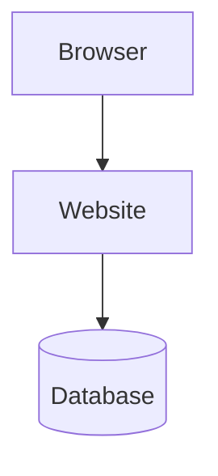
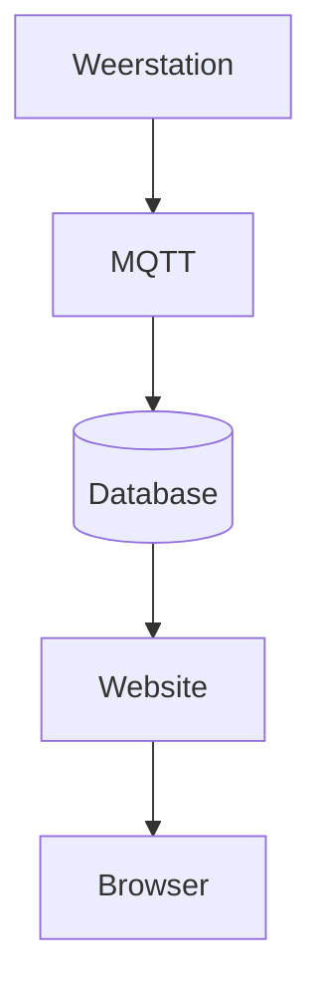

# Een platform in je browser

Instagram, Zalando en Smartschool lijken verschillende sites. Onder de pagina doen ze hetzelfde werk.

<figure markdown="span">
  
  <figcaption>Instagram, Zalando, Amazon en Smartschool. Andere schermen, dezelfde soort site.</figcaption>
</figure>

Je opent ze in een browser. Dat kan op een Windows-laptop, een telefoon of een Chromebook. Het besturingssysteem van het toestel maakt voor de site niet uit. De browser vraagt een pagina, de site antwoordt.

Je logt in met een account.

- Op Instagram zie je jouw feed en jouw berichten. De privéberichten van een klasgenoot zie je niet.
- Op Zalando of Amazon zie je jouw bestellingen en jouw mandje. Een medewerker van de winkel ziet meer: de bestellingen van alle klanten, de voorraad, de betalingen.
- Op Smartschool ziet een leerling zijn vakken. Een leerkracht ziet de klas.

Zelfde soort site, ander profiel. Het profiel beslist wat je mag zien.

De foto's, de bestellingen en de punten staan niet in de pagina zelf. Ze staan in een database. De site haalt op wat bij jouw account hoort en zet dat in de pagina. Zonder database toont de site iedereen hetzelfde lege scherm. Zonder login zou iedereen alles van iedereen zien.

Dat geheel is een platform: een site in de browser, een account met een profiel, en gegevens uit een database.

## Ons project: het weerstation

Wij bouwen een klein platform van diezelfde vorm.

Je maakt een website waarop je kan inloggen en de metingen van je eigen weerstation ziet. Temperatuur en luchtdruk komen binnen, belanden in een database, en verschijnen als tabel en als grafiek. Een gewone gebruiker ziet alleen zijn station. Een beheerder ziet de stations van iedereen. Dat is hetzelfde verschil als tussen een leerling en een leerkracht op Smartschool, of tussen een klant en een medewerker in een webwinkel.

Het weerstation publiceert zijn metingen. Jij bouwt de site die ze toont. Tot dat station er is, laat je je eigen Python-programma testmetingen sturen. Zo kan je verder zonder op de hardware te wachten.

Op het einde draait die site op een computer op school, en daarna op een server. Die stappen komen later. Eerst antwoordt een programma op je laptop.

## Wat je eerst maakt

Het eerste resultaat is nog geen afgewerkte pagina. Het is een Python-programma dat metingen teruggeeft als je erom vraagt. Dat programma kan je meteen testen: in de browser, op een testpagina, met een commando, en met een automatische test.

Daarna maak je de pagina in HTML en CSS, en laat je het programma die pagina serveren. De database, het inloggen en het echte station komen pas als dat staat.

## Volgorde

De volgorde ligt vast. Elk hoofdstuk gaat ervan uit dat het vorige af is.

1. [VS Code](vscode.md), de editor waarin je werkt.
2. [Git en GitHub](github.md). Je maakt een private repository en deelt die met je leerkracht. Vanaf dan bewaar je elk werkend stuk daar.
3. [Een eerste API](fastapi.md). FastAPI antwoordt met metingen, en je test dat op vier manieren.

Daarna, in deze volgorde:

4. HTML, de structuur van de pagina.
5. CSS, de vorm.
6. De pagina laten komen uit FastAPI.
7. Databases vergelijken, en daarna SQL gebruiken voor gebruikers, stations en metingen.
8. De metingen op de pagina zetten, eerst als tabel, dan als grafiek.
9. Wachtwoorden en inloggen. Een wachtwoord heeft pas zin als de site data van een gebruiker toont. Dan bespreken we waarom dat wachtwoord gehasht in de database staat. Een gewone gebruiker ziet alleen zijn eigen stations. Een beheerder ziet ze allemaal. Die controle zit in het programma, niet alleen in een verborgen menu.
10. MQTT, zodat metingen van het weerstation in de database belanden.
11. SSH en de computer op school.
12. De site op een server zetten.

## Hoe je deze cursus gebruikt

Je typt de code zelf in je eigen repository. Elk hoofdstuk eindigt met **Klaar als**: daaraan zie je of je verder mag.

Werk je vast, lees dan eerst het blok *Als het niet lukt* in dat hoofdstuk. De cursus blijft staan. Een hoofdstuk dat je later opnieuw nodig hebt, zoek je links of via het zoekveld.
